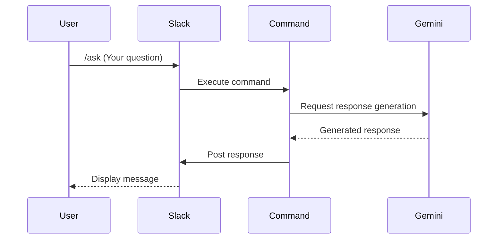
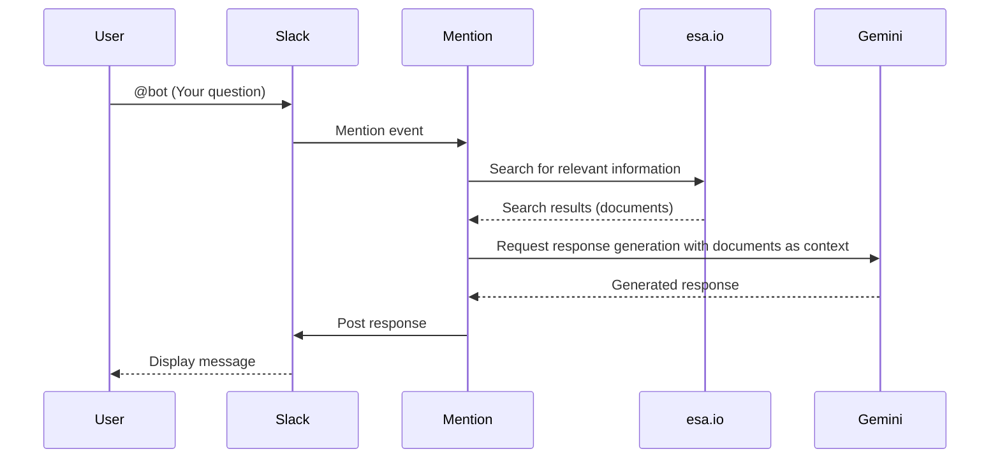

# Slack Bot Agents

This document provides a detailed explanation of the internal architecture, key components (agents), and their interactions for the advanced Slack bot running on Cloudflare Workers.

## 1. Project Overview

This bot aims to streamline communication and enhance knowledge utilization within a Slack workspace.

- **AI-Powered Conversations**: Integrates with Google's powerful generative AI model, "Gemini," to generate natural and accurate answers to user questions.
- **Internal Knowledge Integration**: Connects with the internal knowledge base, "esa.io," enabling the AI to provide answers based on the content of internal documents.
- **Intuitive UI**: Utilizes Slack features like modals and shortcuts to provide a seamless user interface for accessing AI functionalities.

## 2. System Architecture

The system operates on the serverless platform Cloudflare Workers and integrates with external APIs to deliver its features.

- **Execution Environment**: Cloudflare Workers
- **Programming Language**: TypeScript
- **Core Library**: `slack-cloudflare-workers`
- **Integrated APIs**:
    - Slack API
    - Google Gemini API
    - esa.io API

## 3. Setup

To run the bot, you need to configure the following environment variables. Copy the `.vars.example` file in the project root to create a `.vars` file and set the respective values.

- `SLACK_SIGNING_SECRET`: The Signing Secret of your Slack App.
- `SLACK_BOT_TOKEN`: The Bot User OAuth Token for your Slack App.
- `GEMINI_API_KEY`: The API key issued from Google AI Studio.
- `ESA_API_TOKEN`: A personal access token for esa.io.
- `ESA_TEAM_NAME`: Your team name in esa.io.

## 4. Agent Interaction Flow

Each agent collaborates to generate a response based on user actions. Here are the typical interaction flows.

**Flow 1: Question via `/ask` Command**

**Flow 2: Question via Mention (with esa.io Integration)**

## 5. Agent Details

### 5.1. Command Agent

- **Responsibility**: Processes the `/ask` command to provide quick answers from the AI.
- **Trigger**: A user executes the `/ask` command.
- **Process**:
    1. Retrieves the question text from the command.
    2. Passes the text to the `Gemini Agent` to request a response.
    3. Posts the response received from the `Gemini Agent` to the channel where the command was executed.
- **Related Code**: `src/features/ai/handlers/command.ts`

### 5.2. Shortcut Agent

- **Responsibility**: Provides a modal window for asking the AI with more detailed settings.
- **Trigger**: A user executes the `ask-shortcut`.
- **Process**:
    1. Opens a modal for inputting the question, selecting the AI model, and specifying the destination for the result.
- **Related Code**: `src/features/slack/handlers/shortcuts.ts`

### 5.3. Modal Agent

- **Responsibility**: Handles data submission from the modal opened by the `Shortcut Agent`.
- **Trigger**: A user clicks the "Submit" button in the modal.
- **Process**:
    1. Retrieves settings such as "Question," "AI Model," etc., from the modal.
    2. Passes this information to the `Gemini Agent` to request a response.
    3. Sends the generated response as a message to the destination specified in the modal.
- **Related Code**: `src/features/ai/handlers/modal.ts`

### 5.4. Mention Agent

- **Responsibility**: Detects mentions of the bot and provides context-aware responses. It handles the most advanced logic, including the integration with esa.io.
- **Trigger**: The bot is mentioned (`@bot`).
- **Process**:
    1. Retrieves the text and context (e.g., thread) of the mention.
    2. Calls the `Esa Agent` to search for relevant internal knowledge.
    3. Passes the retrieved knowledge as supplementary information to the `Gemini Agent` to request a more accurate response.
    4. Replies with the generated response in the thread of the original mention.
- **Related Code**: `src/features/ai/handlers/mention.ts`

### 5.5. Gemini Agent (Service)

- **Responsibility**: Abstracts the communication with the Google Gemini API, providing a consistent interface.
- **Role**: A service that calls the Gemini API based on prompts from other agents and returns the result.
- **Functions**:
    - Text generation
    - Providing a list of available models
- **Related Code**: `src/features/ai/services/gemini.ts`

### 5.6. Esa Agent (Service)

- **Responsibility**: Abstracts the communication with the esa.io API.
- **Role**: Calls the esa.io API to search for and retrieve documents based on requests from the `Mention Agent`.
- **Library Used**: `esa-api-client`
- **Related Code**: `src/app/index.ts` (for client initialization)